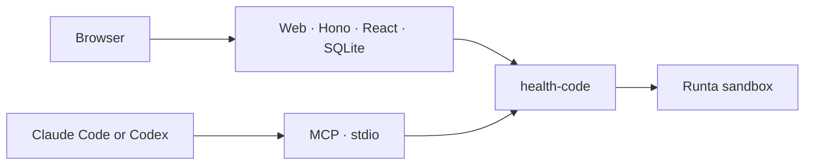

# Health Code

Health Code tests a dependency upgrade on your codebase inside a Runta sandbox. A sandbox is an isolated computer for untrusted code.
An AI agent attempts a repair when an upgrade breaks your checks. Health Code retests the patch before offering it.

## Try it

Paste a public JavaScript or TypeScript GitHub repository at [runhealthcode.dev](https://runhealthcode.dev). Click **New features** and choose a dependency. Then click **Test upgrade**. The report shows which checks passed and any tested patch.

## How it works



Health Code installs your project and runs its typecheck and tests at a pinned commit. It repeats those checks with the upgrade. A patch is retested in a fresh checkout.

Runta restricts installation traffic to package registries and keeps real keys outside the sandbox. The recorded example is mocked and uses no credentials. There are no Health Code accounts or paid tiers.

## MCP setup

Use Health Code from Claude Code or Codex with your own Runta account. Bring a model from Anthropic or an OpenAI-compatible provider. [Use a checkout](apps/mcp/README.md#unpublished-checkout) until the next npm release. You need Node 22.18 or later on the 22.x line. Node 24.11 or later also works.

| Required | Value |
| --- | --- |
| `RUNTA_TOKEN` | Token from your [Runta account](https://dashboard.runta.com). It needs access to runtimes and secrets and the model-provider list. |
| `MODEL_API_KEY` | Model provider key. Only setup needs it. Setup stores it in Runta. |
| `HEALTH_CODE_MODEL_HOST` | Model provider address such as `https://api.anthropic.com`. |
| `HEALTH_CODE_MODEL` | Model ID such as `claude-opus-5-5`. |

1. Set these variables and run `npx health-code mcp setup` from your home directory.
2. Paste the printed entry inside `mcpServers` in `.mcp.json` for Claude Code. For Codex paste it at the top level of `~/.codex/config.toml`.
3. Remove `MODEL_API_KEY` and restart your client with the other variables set.
4. Ask your agent to **list upgrades for this repository**. Choose one and ask it to **test that upgrade and apply its verified patch**.

| Optional | Use |
| --- | --- |
| `HEALTH_CODE_SUMMARY_MODEL` | Model that summarizes release notes. Defaults to `HEALTH_CODE_MODEL`. |
| `HEALTH_CODE_MATCH_MODEL` | Model that matches new features to your code. Defaults to `HEALTH_CODE_MODEL`. |
| `HEALTH_CODE_REPAIR_MODEL` | Model that repairs checks an upgrade breaks. Defaults to `HEALTH_CODE_MODEL`. |
| `HEALTH_CODE_ADOPTION_MODEL` | Model that applies a new feature to your code. Defaults to `HEALTH_CODE_MODEL`. |
| `HEALTH_CODE_MODEL_PROTOCOL` | `anthropic` or `openai-compatible`. Defaults to `anthropic` for `https://api.anthropic.com` and `openai-compatible` for other hosts. Set `anthropic` for a proxy that uses the Anthropic API. |
| `HEALTH_CODE_INPUT_USD_PER_MILLION` | Highest price per million input tokens. Defaults to `10`. |
| `HEALTH_CODE_OUTPUT_USD_PER_MILLION` | Highest price per million output tokens. Defaults to `50`. |
| `GITHUB_TOKEN` | Release notes for public repositories. Add it to the client entry. |

The prices apply to every model you set and drive the spend limits. Set them when your model costs more than the defaults or to use more of each limit with a cheaper model. Run setup again after changing the host or protocol.

See the [MCP guide](apps/mcp/README.md) for its tools and an example session.

## Use the library

The next npm release includes this library.

```sh
npm install health-code
```

```ts
import { inspectRepository } from "health-code"

// reads RUNTA_TOKEN
const report = await inspectRepository({
  repositoryUrl: "https://github.com/ai/nanoid",
  limits: { maxUpgrades: 1 },
})
console.log(report.upgrades)
```

This checks upgrades without a model. See the [library guide](packages/health-code/README.md) to add repairs and read results.

## Run the site locally

Install the Bun version in `.bun-version` and run:

```sh
bun install --frozen-lockfile
bun run --cwd packages/health-code build
bun run --cwd apps/web replay
```

Open `http://localhost:3000` and click **Play recorded inspection**. The recording needs no credentials.

Run `bun run --cwd apps/web dev` for live inspections. It uses the required settings from MCP setup. Run setup once so Runta holds your key and leave `MODEL_API_KEY` set for the site. The [site guide](apps/web/AGENTS.md) covers hosting.

## Development

Run `bash scripts/preflight.sh` for the full test suite. [DEVELOPMENT.md](DEVELOPMENT.md) lists every command and the release steps.

## License

Health Code is available under the [MIT License](LICENSE).
