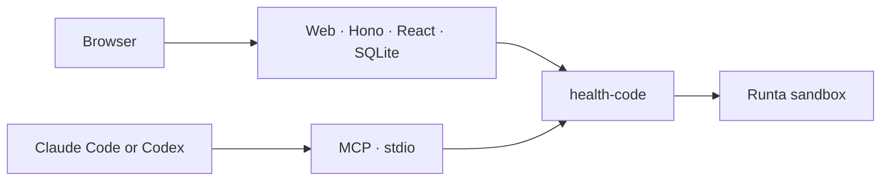

<div align="center">

<picture>
  <source media="(prefers-color-scheme: dark)" srcset="apps/web/public/assets/favicon.svg">
  
</picture>

# Health Code

### Try dependency upgrades before you merge them

The health inspector runs your checks in a Runta sandbox and tries to repair what breaks.

[](https://www.npmjs.com/package/health-code)
[](https://github.com/doubleoevan/health-code/stargazers)
[](https://github.com/doubleoevan/health-code/issues)
[](https://github.com/doubleoevan/health-code/commits)
[](https://www.typescriptlang.org/)
[](https://runta.com/)

[Try the demo](https://runhealthcode.dev) · [Quick start](#quick-start) · [Packages](#packages) · [Architecture](#architecture)

</div>

<!-- DEMO SITE VIDEO: replace this line with the video -->

<!-- MCP VIDEO: replace this line with the video -->

## What it does

Pick an upgrade. The health inspector tries it on your code, attempts to repair what breaks and retests the patch. You get a report with a tested patch when it works.

Your model key stays outside the sandbox.

<a id="mcp-setup"></a>

## Quick start

**On the web:** paste a public JavaScript or TypeScript repository at [runhealthcode.dev](https://runhealthcode.dev).

**In Claude Code or Codex:** needs [Node.js](https://nodejs.org/) 22.18+ or 24.11+, a [Runta](https://dashboard.runta.com) account and a model key.

```sh
export RUNTA_TOKEN=...
export MODEL_API_KEY=...   # setup only
export HEALTH_CODE_MODEL_HOST=https://api.anthropic.com
export HEALTH_CODE_MODEL=claude-opus-5-5

npx health-code mcp setup
```

Paste the printed entry into your client and restart it. Then ask:

```text
Use health-code to list upgrades
```

See the [MCP guide](apps/mcp/README.md#setup) for settings.

## Packages

```text
packages/health-code   Inspection library on npm
apps/web               Demo site
apps/mcp               MCP server and CI command
```

Guides: [library](packages/health-code/GUIDE.md) · [MCP](apps/mcp/README.md) · [development](DEVELOPMENT.md)

## Architecture



[MIT License](LICENSE)
