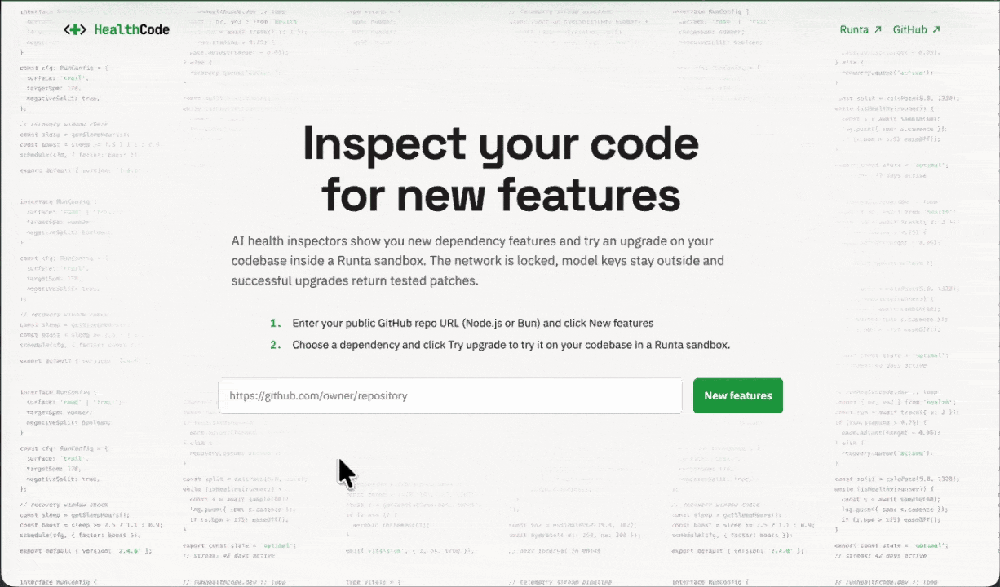
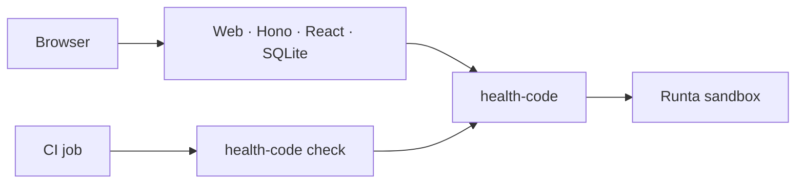

<div align="center">

<picture>
  <source media="(prefers-color-scheme: dark)" srcset="apps/web/public/assets/favicon.svg">
  
</picture>

# Health Code

### Try dependency upgrades before you merge them

The health inspector runs your checks in a Runta sandbox and tries to repair what breaks.

[](https://www.npmjs.com/package/health-code)
[](https://github.com/doubleoevan/health-code/stargazers)
[](https://github.com/doubleoevan/health-code/issues)
[](https://github.com/doubleoevan/health-code/commits)
[](https://www.typescriptlang.org/)
[](https://runta.com/)

[Try the demo](https://runhealthcode.dev) · [Quick start](#quick-start) · [Packages](#packages) · [Architecture](#architecture)

<a href="https://runhealthcode.dev"></a>

</div>

## What it does

Pick an upgrade. The health inspector tries it on your code. It attempts to repair what breaks and retests the patch. You get a report with a tested patch when it works.

The upgraded code runs in a Runta sandbox with the network locked to package registries. Your model key and your CI secrets stay outside it.

## Quick start

**On the web:** paste a public JavaScript or TypeScript repository at [runhealthcode.dev](https://runhealthcode.dev).

<a id="ci-setup"></a>

**In CI:** needs [Node.js](https://nodejs.org/) 22.18+ or 24.11+, a [Runta](https://dashboard.runta.com) account and a model key. Store the model key in Runta once from your own machine:

```sh
export RUNTA_TOKEN=...
export MODEL_API_KEY=...   # setup only
export HEALTH_CODE_MODEL_HOST=https://api.anthropic.com
export HEALTH_CODE_MODEL=claude-opus-5-5

npx health-code setup
```

Then add a job that tries an upgrade and keeps the report and patch:

```yaml
name: Try dependency upgrades
on:
  schedule:
    - cron: "0 6 * * 1"
  workflow_dispatch:
jobs:
  health-code:
    runs-on: ubuntu-latest
    steps:
      - uses: actions/setup-node@v6
        with:
          node-version: 24
      - run: npx health-code check https://github.com/${{ github.repository }}
        env:
          RUNTA_TOKEN: ${{ secrets.RUNTA_TOKEN }}
          HEALTH_CODE_MODEL_HOST: https://api.anthropic.com
          HEALTH_CODE_MODEL: claude-opus-5-5
      - uses: actions/upload-artifact@v4
        with:
          name: health-code-report
          path: health-code-report
```

See the [CI guide](apps/cli/README.md) for settings and options.

## Packages

| Package | Use |
| --- | --- |
| [`health-code`](https://www.npmjs.com/package/health-code) | Inspection library and CI command |
| [`apps/web`](apps/web) | Demo site |

Guides: [library](packages/health-code/GUIDE.md) · [CI](apps/cli/README.md) · [development](DEVELOPMENT.md)

## Architecture



[MIT License](LICENSE)
