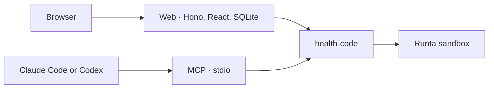

# Health Code

Health Code checks dependency upgrades against your own unit tests in a Runta sandbox. It runs your repository’s test script at a pinned commit, then reruns it with each selected upgrade. If an upgrade introduces a reproducible failure, an agent attempts a repair. Health Code replays the patch in a fresh checkout and reruns the checks before offering it.

## Try an inspection

Paste a public JavaScript or TypeScript GitHub repository URL into the hosted site. The shareable Inspection Report shows which checks passed, which failures were already present, and any tested patch you can apply. If the repository has no test script, the report marks that check as untested. [Try Health Code](https://runhealthcode.dev)

To inspect a repository from Claude Code or Codex, follow the [MCP setup](#mcp-setup).



Live inspections create Runta runtimes, restrict installation traffic to registry hosts and give agents scoped secret stubs. Development replay reads a recording and works without credentials. The hosted service is anonymous. Health Code has no account or paid tier.

## Inspect a repository

The `health-code` package exports the same ESM entry to Node and Bun. Supply a Sandbox Provider and consume the returned versioned JSON Inspection Report. Each caller owns storage and scheduling.

```ts
import { createSandboxProvider, inspectRepository } from "health-code"

const report = await inspectRepository({
  repositoryUrl: "https://github.com/ai/nanoid",
  sandboxProvider: createSandboxProvider(),
  limits: { maxUpgrades: 6, maxDurationMs: 1_800_000, maxCostUsd: 0.25 },
  onEvent(event) {
    console.log(event.sequence, event.type)
  },
})
console.log(report.repository.commit, report.upgrades)
```

Use `provider.checkAvailability()` to check a credential without allocating a sandbox. `SandboxUnavailableError` identifies authentication, permission, and availability errors. Other fatal inspection errors carry the event timeline and any unresolved cleanup identifier. Health Code checks each upgrade from the pinned commit. After transient sandbox loss it can start one replacement within the original time and spend limits. It repeats the baseline, preserves completed upgrades and gives untouched targets a turn before retrying the interrupted one. A partial report shows where work stopped. If the original typecheck fails, Health Code can still compare the upgrade’s install and tests.

Choose **Find upgrades** to browse eligible dependency versions before testing. Search by name, sort minor upgrades first, alphabetically or by workspace count, and filter to **Patch ready**. Each target lists its documented features five at a time, with links to the upstream release notes. Choose one target version to test. A fresh discovery and a fresh test each use one hosted inspection. A ready patch opens immediately. Apply that upgrade’s patch first, then its optional feature patch. If you combine dependency upgrades, rerun your typecheck and tests on the combined changes.

The hosted repository sandbox has 8 GiB of physical memory. Tools such as oxlint can reserve larger virtual address ranges and consume RAM as they use the pages.

The Node adapter supports npm, pnpm, Bun, and Yarn workspaces. It selects stable minor and major upgrades and confirms new failures against the pinned Baseline. Consumers can highlight Sandbox Events in a live log or replay them from the report timeline.

Read each upgrade's `install.status` for the install command's Check Result. Its `observation.findings` list records off-registry connections, connection attempts with an unknown destination hostname, and writes outside the project. Check `observation.complete` alongside that list. Even an empty list leaves the Upgrade Check untested when coverage is incomplete.

## Inspection site

Build the library with `bun run --cwd packages/health-code build`, then run `bun run --cwd apps/web dev`. Open `http://localhost:3000` and submit the prefilled fixture URL. The same short link displays the live log and the completed Inspection Report. Development replay streams a recorded library inspection with fixture model responses.

The hosted upgrade menu reads release notes without model calls. For a selected upgrade, Opus 5.5 summarizes releases and matches features to code. Fable 5.2 handles repair and feature adoption when needed. Reports publish verified Patch bytes and application prompts when GitHub detects an OSI-approved license at the inspected commit. See [site operations](apps/web/AGENTS.md) for the Northflank Dockerfile, SQLite backups, deployment namespace and startup recovery.

To apply a tested Patch from a licensed Inspection Report, choose **Copy patch instructions** and paste them into Claude Code or Codex from the repository checkout. The instructions include the download URL, SHA-256 digest and tested commit. A Feature Patch also identifies its required Upgrade Patch.

## MCP setup

Health Code runs as a local Node stdio server in Claude Code or Codex. The server saves evidence on your machine. Your Runta account pays for sandbox time and your model account pays for inference. The coding agent uses its own checkout and GitHub permissions for the pull request.

The next `health-code` npm release includes the library and the MCP executable. It supports Node 22.18 or later on the 22.x line, or Node 24.11 and later.

1. Create a Runta account and set `RUNTA_TOKEN`. The token needs access to runtimes, secrets and the model-provider list for your organization. For first-time registration or rotation, also supply `ANTHROPIC_API_KEY` to the setup process. [Runta signup](https://dashboard.runta.com)
2. From your home directory, run `npx health-code mcp setup`. Setup verifies the stored key with one authenticated request in a Model Request Sandbox, deletes the model request sandbox, then prints both client entries. You can repeat setup with just `RUNTA_TOKEN` once the origin’s key is registered.
3. Paste the Claude Code entry inside `mcpServers` in the project’s `.mcp.json`, or the Codex entry at the top level of `~/.codex/config.toml`. Both pin the installed version and resolve the command from your home directory.
4. Start or restart your client with `RUNTA_TOKEN`. The MCP uses the model key stored in Runta for all four roles. When migrating an existing configuration, replace the old client entry and remove its model-key reference. You can remove your local model key after setup succeeds.

Library callers can select `callerModelExecution: "modelRequestSandbox"` and pass stored-credential routes for all four roles. Omitting the option keeps summaries and Code Feature Matches in the caller’s process. A model request sandbox starts on the first eligible request. Each model request sandbox call has up to 120 seconds within the Inspection’s remaining work time. The Inspection Report records runtime cost bounds separately from model charges. **Usage as of** (`runtimeUsage.usageAsOf`) gives the time through which runtime usage was measured.

To use an unpublished checkout, build the library with `bun run --cwd packages/health-code build`, then run `bun run --cwd apps/mcp build`. Use `node packages/health-code/dist/mcp/cli.js mcp setup` in your secret environment. In the printed client entry, use `node` as the command and pass the absolute path to that file followed by `mcp` as the arguments.

| Environment variable | Use |
| --- | --- |
| `RUNTA_TOKEN` | Account check, secret registration and live sandbox access. |
| `ANTHROPIC_API_KEY` | One-time registration or rotation during setup. |
| `HEALTH_CODE_MODEL_HOST` | HTTPS Anthropic-compatible origin. Defaults to `https://api.anthropic.com`. Run setup for the chosen origin. |
| `HEALTH_CODE_SUMMARY_MODEL`, `HEALTH_CODE_MATCH_MODEL`, `HEALTH_CODE_REPAIR_MODEL`, `HEALTH_CODE_ADOPTION_MODEL` | Select each live model role. The default is `claude-opus-5-5`. |
| `HEALTH_CODE_INPUT_USD_PER_MILLION`, `HEALTH_CODE_OUTPUT_USD_PER_MILLION` | Upper bounds for model cost reservations. Supply both for a custom host or model. |
| `GITHUB_TOKEN` | Optional release-note access for public repositories. To opt in, add this variable to the client entry. |

### Example agent session

Ask your agent to **list upgrades for this repository, test the upgrade I choose and apply its verified patch**.

1. Call `list_upgrades` with the public GitHub `repositoryUrl`. Review the versions and documented features. To browse more, pass the returned `upgradeMenuId` and pass `nextOffset` as `offset`.
2. Call `get_upgrade` with `upgradeMenuId`, `dependency` and `to` from the upgrade menu. It returns the verified upgrade patch or the check results explaining why none was produced.
3. Compare the local remote and HEAD with the inspected repository and commit. To fetch additional patch pages, pass the inspection ID, digest and offset to `get_tested_patch`. New discovery and testing stream step and sandbox events as MCP progress notifications. A saved upgrade menu skips sandbox discovery and fetches release notes for the visible page. Saved patches open from local storage. Replay the log with `read_inspection`.
4. Concatenate each Patch’s text pages verbatim. Verify the SHA-256 digest, follow the library prompt and apply the prerequisite series first on a new branch. Run the typecheck and tests without editing tests. Open the authorized pull request.
5. Call `report_patch_result` with the ID, digest, `application` (clean or adapted), `tests` (passed, failed or not_run) and optional `pullRequest`. Supply `adaptation` for an adapted Patch.

Completed Inspection Reports live under `~/.health-code/inspections/<inspection-id>/inspection-report.json`. Restart either client and read by the same ID without credentials. Developer-reported results are separate from the library Verdict. Closing the local server interrupts active Inspections. Public links belong to hosted Inspections.

## Development

Use the Bun version in `.bun-version`. From the repository root, run `bun install --frozen-lockfile`, then `bash scripts/preflight.sh`. The test suite covers repository checks and the inspection engine using recorded fixtures. Claude Code runs the same comment check after file edits and writes. Hook mode uses `jq` to read the edited path. For `.tsx`, follow the JSX section-comment rules and review them during `/ship`.

| Command | What it checks |
| --- | --- |
| `bun run check` | Runs preflight, the same command used by CI and /ship. Stops at the first failure. |
| `bash scripts/check-comment-groups.sh --tracked` | Flags runs over eight uncommented statement lines in tracked `.ts`, `.mts`, `.js`, `.mjs` and `.sh` files. |
| `bun run check:style` | Checks formatting, lint rules, and import order with Biome. |
| `bun run check:structure` | Checks the placement of package manifests. |
| `bun run check:boundaries` | Checks imports, dependency declarations, and TypeScript references across the workspaces. |
| `bun run check:pins` | Compares the Bun pins and verifies patched dependency versions against the lockfile. |
| `bun run check:unused` | Finds unused files, exports, types, and dependencies with Knip. |
| `bun run typecheck` | Typechecks the scripts and every product workspace. |
| `bun run test` | Runs the tooling and workspace test suites with Bun. |
| `bun run --cwd packages/health-code build` | Builds the ESM library, declarations, and the sandbox guest tools. |
| `bun run inspect <repo-url> [--fake]` | Prints the live inspection log and saves the versioned Inspection Report to `logs/`. Use `--fake` for a credential-free fixture replay. For a live inspection, use `doppler run -- bun run inspect <repo-url>`. |
| `bun run --cwd apps/mcp build` | Compiles the Node CLI from `apps/mcp` into `packages/health-code/dist/mcp/`. |
| `bun test ./apps/mcp` | Exercises the MCP tools, account setup, private storage and the packed Node subprocess offline. |
| `bun run --cwd apps/web build` | Builds the Vite browser entry for the Hono server. |
| `bun run --cwd apps/web start` | Serves the built page, Inspection API and event stream. |
| `bun run --cwd apps/web dev` or `replay` | Serves credential-free replay with React Fast Refresh, live CSS and server source reload. |
| `bun run check:package` | Packs the library and verifies its public entry in fresh Node and Bun consumers with frozen workspace dependencies. |
| `bun run test:provider` | Runs the shared production contract and two pinned public fixtures when the test harness has `RUNTA_TOKEN`. |
| `doppler run -- bun run eval --case typescript-7` | Scores the historical repair under the default limits. `--all` scores both cases. |
| `doppler run --only-secrets RUNTA_TOKEN -- bun run eval --case carlnotes-baseline --record` | Measures test counts and test file errors at the pinned commit and writes the case file for review. |
| `bun run check:advisories` | Queries the registry and fails on unreviewed high or critical advisories or stale exceptions. CI runs it separately. |

Every module keeps its own AGENTS.md current with this README. For an approved change, implement it, run `/ship`, archive with OpenSpec, commit the implementation and archive together, then push to main.

Preflight needs no credentials. Doppler project `health-code`, config `dev`, holds application secrets. See [AGENTS.md](AGENTS.md) for module ownership, test rules, and the shipping workflow.

### Inspections with models

Pass configured model handles in `models.releaseSummary` and `models.featureMatch`. Give each a caller-owned pricing bound in USD per million input and output tokens and a maximum input token count. For `models.repair` and `models.featureAdoption`, supply the protocol, HTTPS base URL, model ID, pricing and a stored credential name with its header and value template. The library verifies the scoped binding inside the sandbox. Each returned Patch includes its tested commit, mailbox and application instructions.

An Inspection with models defaults to 60 minutes and $15. Repair gets up to 40 turns, 20 minutes and $4. Feature adoption gets up to 25 turns, 10 minutes and $2. Each agent turn allows up to 8,192 output tokens. Set a lower turn limit with `limits.agent.repair.maxTurns` or `limits.agent.featureAdoption.maxTurns`. Set total spending and time under `limits`. Existing model-free calls and legacy string dictionaries return version 1.

A caller can use the same configured model for summaries and matching. The guest route carries the stored credential name. The two model handles stay in the calling process.

```ts
import { inspectRepository } from "health-code"

const report = await inspectRepository({ repositoryUrl, sandboxProvider, models })
```

Run `bun run test:credential` with the sandbox token and `HEALTH_CODE_STORED_CREDENTIAL` set to the stored Anthropic key's name to verify the live gateway. Run `bun run eval --case typescript-7` to score the pinned repair against the default budgets. The CarlNotes case supports `--record` for a new measurement. Scoring requires reviewed counts and test file errors.


The public type for a version 2 Inspection Report is `InspectionReportV2`. A **Direct replacement** cites release text connecting the feature to its **Source location**. An **Inferred replacement** records the evidence available. The report also identifies **Affected call sites** and the **Adoption outcome** for each match.

A **Final patch check** produces **Patch verification**. **Download patch** provides the Git mailbox. **Applies to commit**, **Tested commit** and **Required upgrade patch** identify how to apply it. Each entry under **Added dependencies** identifies the reviewed commit. **Why repair stopped** gives the recorded diagnosis. **Installed size change** reports the difference in bytes.

**Model cost** uses recorded token usage and the caller’s pricing. **Reserved upper bound** shows the amount retained for a request whose receipt is missing. **Output tokens** reports measured reply tokens.

The **Test file errors** list (`testFileErrors`) records the file and reason for each load, setup or other runner error outside a named case. Named test failures and skips have their own counts.


## Release and hosted verification

Run `bash scripts/release-packages.sh --dry-run` to build and inspect both npm tarballs locally. Both packages trust `doubleoevan/health-code` and `release.yml` with staged publishing permission and no GitHub environment. A matching tag stages both tarballs with provenance. Approve the library and then the scoped MCP version on npmjs.com. Run the release workflow manually against the same tag to verify the public digests and signed provenance. If a stage is already pending, review it on npmjs.com before retrying the workflow.

Run `bun x playwright install chromium` once for browser acceptance. Use `bun run test:hosted` with the deployment origin, its Runta namespace and its inventory credentials supplied through Doppler. The browser uses the public submission form, including Turnstile. Each completed case writes its report URL, revision, prompt versions and observed verdicts under `logs/hosted/`. A new hosted deployment commit starts a fresh inspection cache. Existing report links keep working. Retrying a partial inspection checks the baseline again, reuses completed upgrades at the same commit and release, and runs the remaining upgrades under the usual limits. Each reused upgrade links to the inspection that tested it. The script reopens CarlNotes through the cache and checks provider inventory for leftover runtimes. A daily cap can require continuing the suite after midnight UTC.

## License

Health Code is available under the [MIT License](LICENSE).
